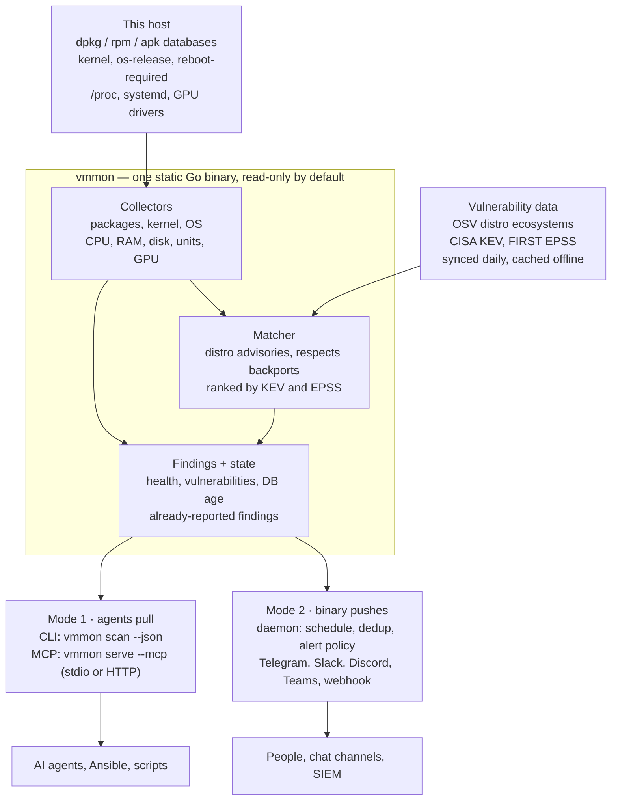

# ADR-001: VM Monitor — host vulnerability & health agent

- **Status:** Proposed
- **Date:** 2026-11-02
- **Author:** Vitalii Yeromin

VM Monitor ships as one static Go binary per Linux host that inventories packages and the kernel, matches them against vulnerability data, reports host health, and exposes all of it through a CLI and an MCP server — with an optional daemon mode that pushes alerts to Telegram, Slack, Discord, Teams or a webhook.

## Context

Anyone running Linux VMs has to know when an installed package or the running kernel gains a known vulnerability. Today that means a heavy scanner (Trivy, Grype), an agent platform (Wazuh), or nothing at all.

Two client segments shape the design:

| Segment | Scale | What they need | How they install |
| --- | --- | --- | --- |
| Power users | 1–10 VMs | "Tell me on Telegram when something is wrong"; zero config; no security expertise | Homebrew, a curl one-liner, or a single `.deb` |
| Enterprise | Hundreds of VMs, built from templates | Fleet rollout, no alert storms, machine-readable output for their SIEM | Ansible against an internal package repo |

Idea history:

1. 22 Oct 2026 — Linux app that checks package, kernel and OS versions for vulnerabilities and messages Telegram. Alternative raised: a Hermes-agent skill run once a day.
2. 25 Oct 2026 — reframed as an ultra-slim binary with a built-in MCP server, exposing host health, status and findings to agents; "CleanMyMac, but CLI and better"; skills for basic checks (CPU, RAM); niche GPU/compute metrics; two work modes (agent pulls vs binary pushes notifications).

## Decision drivers

The deciding driver is that alerting must work with no LLM in the loop; agents are a consumer, not a dependency.

1. **Deterministic core.** A scan gives the same result every run and costs nothing per run. An agent skill that "checks for vulnerabilities" is only as good as the data source it calls, so the data source is the product.
2. **Slim and dependency-free.** One static binary, no Python, no Docker, no runtime. Targets: binary under 25 MB, idle RSS under 30 MB, scan under 10 s on a typical VM.
3. **Low false positives.** Distros backport fixes without bumping upstream versions, so matching must use distro advisories, not upstream CVE ranges.
4. **Safe to hand to an agent.** Read-only by default; no tool may change the host unless explicitly enabled.
5. **Fleet-friendly.** Config file plus env vars, idempotent install, a systemd unit, packages Ansible can install from a repo.
6. **Private by default.** No telemetry. Package lists leave the host only if the user picks online lookup mode.

## Considered options

Option C wins: it is the only one that serves both segments and both work modes from one artifact.

| Option | What it is | Works without an LLM | Footprint | Fleet via Ansible | Main problem |
| --- | --- | --- | --- | --- | --- |
| A. Agent skill only | Hermes-agent skill runs daily, lists packages, asks the model to check them | No | Needs an agent runtime + model on or near every host | Poor | Model has no vuln database; results vary run to run; per-run token cost × hundreds of hosts |
| B. Wrap an existing scanner | Cron + Trivy/Grype JSON + a notify script | Yes | Trivy/Grype binaries are large and pull a DB of hundreds of MB | OK | No MCP, no health metrics, glue code is the whole product |
| **C. Single binary: CLI + MCP + daemon** | One Go binary; `scan`, `serve --mcp`, `daemon` subcommands | Yes | One file, small DB per distro | Good | We own inventory and matching logic |
| D. Agent + central server | Thin host agent reporting to a hosted backend | Yes | Small agent, plus a service to run | Good | Becomes a SaaS; kills the privacy story for power users; too much for v1 |

The Hermes skill idea survives as a thin layer: a skill pack that calls the binary's MCP tools. The skill decides what to ask; the binary supplies the facts.

## Competitive landscape

OSV.dev is the data source, not the competitor. The competitors are the scanners built on top of such data, and none of them targets always-on, low-noise monitoring of a VM fleet that agents can query.

| Tool | Built for | Cons for continuous VM monitoring |
| --- | --- | --- |
| [osv-scanner](https://github.com/google/osv-scanner) (Google) | Project dependencies and container images | Host scanning is secondary; documented OS-package support is image scanning for Alpine, Debian, Ubuntu; RPM extraction only [wired into the image preset in 2026](https://github.com/google/osv-scanner/pull/2937). No daemon, alerting, state or health. Online mode sends package names, versions and file hashes to the API. |
| Trivy (Aqua) | CI/CD and container security: images, IaC, secrets, SBOMs | Large binary and DB for a VM that needs a fraction of it. One-shot scans, no scheduler or "new since yesterday". Its [MCP plugin](https://playbooks.com/mcp/aquasecurity/trivy-mcp) targets IDEs: project folders, images, repos. |
| Grype (Anchore) | Images, filesystems and SBOMs in pipelines | DB [decompresses to about 1.7 GB](https://earthly.dev/lunar/integrations/collectors/grype/); VMware recommends [4 GiB storage](https://docs.vmware.com/en/VMware-Tanzu-Application-Platform/1.9/tap/scst-scan-ivs-grype.html). No daemon or alerting. The [official MCP server](https://pypi.org/project/grype-mcp/) is a Python bridge to the CLI. |
| Vuls | Agentless fleet scanning from a central server over SSH | Closest to this idea; already reports to Slack and email. Multi-component setup with separate dictionary services for NVD and OVAL data. Central server needs SSH to every host. CVSS-threshold alerts are noisy. No MCP, no health metrics. |

How vmmon differs:

1. **Footprint per host:** one static binary plus only the host's own distro data, tens of MB instead of gigabytes.
2. **Continuous by design:** daemon, state, new-findings-only alerts and digests are core, not glue around a CLI.
3. **Low noise by default:** alerts fire on KEV-listed or fix-available findings, not raw CVE counts.
4. **Health and vulnerabilities together:** disk, failed units, pending reboot, GPU errors and new CVEs answer one question: is this VM OK?
5. **Host-centric MCP:** tools describe this host's state, not a project folder or image.
6. **No central server:** each host reports for itself; Ansible only installs a package. No SSH fan-out.

Where they are better: Trivy and Grype have years of matching edge cases fixed, broader data, SBOM and VEX support, and large communities. Vuls is battle-tested on fleets and has a web UI. MCP alone is not a moat, since Trivy and Grype both have MCP servers; the edge is host health, vulnerabilities and alerting behind one MCP surface.

## Decision

Build option C: a single static binary (working name `vmmon`) with three entry points over one shared core.



Both modes read the same findings; the daemon only adds scheduling, dedup and notifiers on top.

Command surface:

- `vmmon setup [channel]` — interactive notification setup for power users (see below)
- `vmmon scan [--json] [--root PATH]` — one-shot scan of this host or a mounted image
- `vmmon status` — health summary for humans
- `vmmon serve --mcp [--http 127.0.0.1:PORT]` — MCP server for agents
- `vmmon daemon` — scheduled scans and notifications, run by systemd
- `vmmon notify test` — resend a test message to every configured channel
- `vmmon db sync` — refresh the offline vulnerability data

One config file, `/etc/vmmon/config.yaml`, overridable by env vars; notifier URLs and tokens can come from env so Ansible Vault never writes them to disk in plain text.

## Power-user setup: `vmmon setup`

One command takes a power user from install to a working Telegram alert in about two minutes, with no config file to edit.

```bash
sudo vmmon setup
```

1. **Pick a channel.** Telegram is the default. Slack, Discord, Teams and webhook only ask for a URL, then send a test.
2. **Paste the bot token.** The user creates a bot with @BotFather and pastes its token. vmmon validates it with `getMe` and shows the bot's name. One bot can serve every VM; each message starts with the hostname.
3. **Pair the chat.** vmmon prints a one-time link `https://t.me/<bot>?start=<code>`, plus a QR code in the terminal. The user taps it. vmmon polls `getUpdates` for up to 3 minutes, takes the chat ID from the message carrying that code, and ignores everything else. For a team chat, add the bot to a group and send `/start <code>` there.
4. **Send a test message.** Setup fails loudly if it does not arrive.
5. **Choose an alert policy preset.** Quiet (default): KEV-listed or fix-available findings, plus a daily digest at 09:00 local. Critical only. Everything.
6. **Write the config and start.** Writes `/etc/vmmon/config.yaml` and the token to `/etc/vmmon/secrets.env` (root, mode 0600). Runs `systemctl enable --now vmmon`, runs a first scan and sends its summary.

Re-running setup is idempotent: it shows the current values and changes only what the user edits. A non-interactive form serves scripts and Ansible: `vmmon setup telegram --token-file PATH --chat-id ID --policy quiet --yes`. The Homebrew formula cannot run a root wizard itself, so its caveats tell the user to run `sudo vmmon setup`.

**Polling, not a Telegram webhook.** Telegram's `setWebhook` needs a public HTTPS endpoint on the host, on port 443, 80, 88 or 8443. That means opening an inbound port and managing TLS on the very machine being protected, and most power-user VMs have no domain. Sending alerts needs only outbound `sendMessage`, and pairing needs one short `getUpdates` poll, so vmmon never listens for Telegram. If bot commands (`/status`, `/scan`, `/mute`) come later, they use long polling too. If the bot already has a webhook set, `getUpdates` is blocked; setup reads `getWebhookInfo`, tells the user, and never deletes the webhook silently. The generic outgoing webhook channel is unaffected.

## Key sub-decisions

| Area | Decision | Why | Rejected |
| --- | --- | --- | --- |
| Language | Go, `CGO_ENABLED=0`, static build | Mature libraries for this exact job: osv-scalibr / go-rpmdb for inventory, the official MCP Go SDK, Shoutrrr for notifiers; trivial cross-compile | Rust: smaller binary, but thinner ecosystem for rpmdb and MCP; Python: not a slim binary |
| Inventory | Reuse osv-scalibr extractors (the library behind osv-scanner) to read dpkg status, rpmdb and apk installed; `uname -r` + `/etc/os-release`; installed vs running kernel; `reboot-required` | Inherits Google's parsing and version-comparison fixes, so effort goes to the differentiators; no shelling out to package managers; works on an offline rootfs too | Own dpkg/rpm/apk parsers (re-solving solved bugs); parsing `apt list` / `dnf` output (slow, locale-dependent) |
| Vuln data | OSV as the primary source, using its distro ecosystems (Debian, Ubuntu, Alpine, Rocky, AlmaLinux, …); offline per-ecosystem DB synced daily, online batch API as a fallback | Distro advisories respect backports; one schema across distros | Matching upstream CVE ranges from NVD (false positives on every backport) |
| Prioritisation | Enrich findings with CISA KEV and FIRST EPSS | Lets alerts fire on "exploited in the wild" or "fix available", not on raw CVE count | Alerting on CVSS alone |
| Kernel | Match only via distro kernel advisories; flag running ≠ installed kernel | The kernel CNA issues thousands of CVEs a year; raw matching is pure noise | Matching `uname` against upstream kernel CVEs |
| MCP transport | stdio by default; Streamable HTTP opt-in, bound to 127.0.0.1, bearer token required for any other bind | Agents on the host or over SSH need nothing exposed; remote is explicit | Listening on 0.0.0.0 by default |
| MCP surface | Read-only tools; anything that changes the host is behind a config flag and off by default | Safe to give to any agent | Remediation tools in v1 |
| Notifications | One notifier interface over Shoutrrr URLs: Telegram, Slack, Discord, Teams, generic webhook (JSON) | All five are one integration; webhook JSON feeds an enterprise SIEM | Hand-writing five clients |
| Alert state | Local state file of already-reported findings; alert on new findings only, plus a daily or weekly digest | Prevents re-alerting the same CVE every run on hundreds of hosts | Stateless alerts |
| Distribution | GoReleaser: static tarballs, `.deb`/`.rpm`/`.apk` via nfpm with a systemd unit, a Homebrew tap, checksums + signatures | Packages suit root daemons and fleets; Homebrew suits power users | Homebrew as the only channel (installs per-user under linuxbrew, awkward for a system service) |
| Fleet | Ansible collection with one role: install from repo, template `config.yaml`, manage the systemd unit, store secrets in Vault | Idempotent; matches how enterprise clients already work | Custom fleet installer |
| Onboarding | `vmmon setup` wizard: Telegram pairing via a one-time deep link and a short `getUpdates` poll; non-interactive flags for Ansible | Two-minute path from install to first alert; no inbound port on the host | Telegram `setWebhook` (needs public HTTPS on the monitored host); making users find their chat ID by hand |
| Templates | `scan --root <path>` scans a mounted image rootfs | Scan a golden template once instead of every clone | — |

## Scope

v1 is a Linux-only, read-only scanner with MCP and push alerts; GPU metrics and cleanup come later.

Phases, each shippable on its own:

1. **Scan core** — inventory for Debian/Ubuntu, RHEL family, Alpine; OSV offline matching; KEV/EPSS enrichment; `vmmon scan --json`.
2. **Health + MCP** — CPU, RAM, disk, load, uptime, failed systemd units, pending reboot; `vmmon serve --mcp` over stdio with tools: `host_status`, `os_info`, `list_packages`, `scan_vulnerabilities`, `get_vulnerability`, `pending_updates`.
3. **Daemon + notifiers** — scheduler, alert state, policies (min severity, KEV-only, fix-available-only), digests, all five channels, and the setup wizard with Telegram pairing.
4. **Distribution** — GoReleaser packages, apt/yum repo, Homebrew tap, Ansible collection, docs.
5. **Niche metrics** — GPU collectors (NVIDIA first: ECC errors, XID events, throttle reasons, PCIe/NVLink errors), loaded via `dlopen` so the default build stays static.
6. **Later, if wanted** — Hermes/Claude skill pack on top of the MCP tools; read-only "reclaimable space" report (the CleanMyMac idea); optional fleet aggregator.

Non-goals for v1:

- Deleting files, upgrading packages or any other change to the host.
- Container image or language-dependency scanning (Trivy and Grype cover it).
- macOS and Windows.
- A hosted backend or web dashboard.

## Consequences

We gain one artifact that serves both segments, but we own inventory and matching quality.

- **Positive:** works with or without an agent; no per-scan cost; installs the same way on 1 VM or 500; offline mode keeps package lists on the host.
- **Negative:** accuracy of matching is now our problem; each new distro is real work; OSV distro coverage gaps become our gaps.

## Risks

| Risk | Mitigation |
| --- | --- |
| Noise from unfixed CVEs drowns real alerts | Default policy: alert only on fix-available or KEV-listed; the rest go to the digest |
| Alert storm across a fleet hitting the same CVE | Per-host dedup now; recommend the webhook into a SIEM for enterprise; fleet aggregation is a later decision |
| MCP over HTTP becomes an attack surface | Loopback-only default, token auth, read-only tools, no shell tool ever |
| Overlap with Vuls / Trivy | Position on MCP-native access, health + GPU metrics, and footprint; benchmark size and scan time against them |
| Stale offline DB gives false "all clear" | Report DB age in every result; alert if sync fails for 48 h |

## Open questions

- [ ] Final name and binary name (`vmmon` is a placeholder).
- [ ] Confirm Go over Rust.
- [ ] Is a fleet aggregator in scope for the enterprise segment, or is webhook-to-SIEM enough?
- [ ] License: Apache-2.0 for adoption, or AGPL to protect a future hosted tier?
- [ ] Does the "CleanMyMac" idea stay a read-only report, or become a separate tool?
- [ ] Which GPU vendors after NVIDIA (AMD ROCm, Intel)?
- [ ] Check OSV coverage for RHEL itself before promising RHEL support.
- [ ] Two-way Telegram bot commands (`/status`, `/mute`) in v1, or later?
