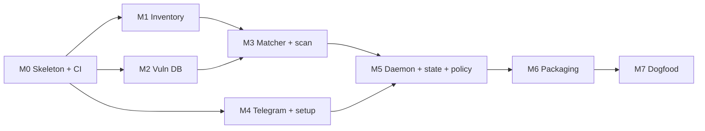

# vmmon MVP build plan

- **Status:** Draft
- **Date:** 2026-11-02
- **Implements:** [ADR-001](adr/0001-vm-monitor-concept.md)

The MVP is one static binary that, on a Debian or Ubuntu VM, installs in a minute, pairs with Telegram via `vmmon setup`, keeps its own vulnerability database fresh, re-checks the host after every database sync and every package change, and sends a Telegram alert only for new findings that pass the alert policy. Eight milestones, roughly 18–26 focused days.

## MVP definition

The MVP is done when all of this works on a fresh Debian 12 and Ubuntu 24.04 VM, amd64 and arm64:

1. `curl … | sh` (or the `.deb`) installs the binary and the systemd unit.
2. `sudo vmmon setup` pairs a Telegram chat, sends a test message and starts the daemon.
3. The first scan's summary arrives in Telegram.
4. The daemon syncs the vulnerability database on a schedule. When a new advisory affects an installed package, one alert arrives within one sync cycle, and never again for the same finding.
5. Upgrading the vulnerable package resolves the finding; the next digest says so.
6. `vmmon scan --json` works fully offline from the local database.
7. If the database cannot sync for 48 h, Telegram gets a staleness warning.

### Scope

| In the MVP | Deferred (post-MVP) |
| --- | --- |
| Debian 12, 13; Ubuntu 22.04, 24.04 (dpkg only) | RHEL family, Alpine |
| OSV offline DB: full download + incremental sync | Online OSV API mode |
| KEV + EPSS enrichment, alert policy presets | Custom policy expressions |
| Telegram: setup wizard, alerts, daily digest | Slack, Discord, Teams, generic webhook |
| Daemon: scheduled sync, package-change rescans, state, dedup | Two-way bot commands (`/status`, `/mute`) |
| `vmmon status`: findings, DB age, pending reboot, last scan | CPU/RAM/disk health, GPU metrics |
| Static tarballs, `.deb`, `install.sh`, Homebrew tap | `.rpm`/`.apk`, apt repo, Ansible collection |
| — | MCP server (first thing after the MVP) |

## Command surface (MVP)

| Command | Purpose |
| --- | --- |
| `vmmon setup [telegram]` | Interactive wizard; non-interactive with `--token-file --chat-id --policy --yes` |
| `vmmon scan [--json] [--root PATH]` | One-shot scan against the local DB |
| `vmmon db sync [--full]` / `vmmon db status` | Refresh the DB / show ecosystems, record counts, age |
| `vmmon daemon` | Long-running loop, started by systemd |
| `vmmon status` | Open findings, DB age, pending reboot, last scan, channel health |
| `vmmon notify test` | Send a test message |
| `vmmon inventory --json` | Debug: what the host has installed, with source names |
| `vmmon version` | Build info |

## Architecture

### Code layout

```text
cmd/vmmon/            main: wires cobra commands
internal/config/      config.yaml + env overrides + secrets.env
internal/inventory/   os-release, dpkg packages (via osv-scalibr), kernel, reboot-required
internal/vulndb/      download, verify, filter, index (bbolt), atomic swap, incremental sync
internal/enrich/      CISA KEV, FIRST EPSS
internal/match/       dpkg version comparison, OSV range evaluation, CVE alias dedup
internal/finding/     finding model, stable IDs, severity/fix status
internal/state/       reported findings, last scan, last sync (bbolt)
internal/policy/      presets: quiet, critical, everything
internal/notify/      Notifier interface + Telegram implementation, message rendering
internal/telegram/    minimal Bot API client: getMe, getUpdates, sendMessage, getWebhookInfo
internal/daemon/      scheduler, triggers, graceful shutdown
internal/setup/       wizard
packaging/            systemd unit, install.sh, goreleaser config
testdata/             dpkg status fixtures, frozen OSV snapshots, golden outputs
```

### Dependencies

| Need | Choice | Note |
| --- | --- | --- |
| CLI | `spf13/cobra` | |
| Config | `gopkg.in/yaml.v3` | env overrides by hand, no viper |
| Inventory | `google/osv-scalibr` dpkg extractor | as decided in the ADR |
| Local DB | `go.etcd.io/bbolt` | pure Go, keeps `CGO_ENABLED=0` |
| Logging | `log/slog` | journald picks up stdout |
| Telegram | own ~300-line client | Deviation from the ADR's Shoutrrr choice: Shoutrrr cannot do `getUpdates` pairing. Revisit Shoutrrr when other channels land. |
| QR code in terminal | `mdp/qrterminal` | setup only |

### On-disk layout

```text
/usr/local/bin/vmmon
/etc/vmmon/config.yaml          0644  channels, policy, schedule
/etc/vmmon/secrets.env          0600  VMMON_TELEGRAM_TOKEN=…
/var/lib/vmmon/db/<eco>.bolt    indexed OSV records for this host's release only
/var/lib/vmmon/db/meta.json     per-source last sync, record counts, checksums
/var/lib/vmmon/db/kev.json, epss.bolt
/var/lib/vmmon/state.bolt       reported findings, last scan, last digest
```

### systemd unit

The daemon does not need root: `/var/lib/dpkg/status`, `/etc/os-release` and `/proc` are world-readable. So the unit runs with `DynamicUser=yes`, `StateDirectory=vmmon`, `EnvironmentFile=/etc/vmmon/secrets.env` (read by systemd before dropping privileges), `ProtectSystem=strict`, `ProtectHome=yes`, `NoNewPrivileges=yes`, `PrivateTmp=yes`, and outbound network only. Only `vmmon setup` needs root, to write `/etc/vmmon` and enable the unit.

## Core logic

### Inventory

- Read `/etc/os-release` → `Debian:12` or `Ubuntu:24.04:LTS`. Unsupported release → clear error, not an empty scan.
- Read dpkg status via osv-scalibr. OSV distro records are keyed by **source** package (Ubuntu documents this explicitly), so each installed binary package is mapped to its source name and source version from the `Source:` field. When the field carries a version in parentheses, that version is the one to match; when the field is absent, source = binary name and version.
- Kernel: running version from `uname -r`, installed `linux-image-*` packages, `/var/run/reboot-required`. A fixed kernel that is installed but not running stays an open finding with "reboot required".

### Vulnerability DB sync

1. **First sync:** download `https://storage.googleapis.com/osv-vulnerabilities/<Ecosystem>/all.zip` for the host's distro only. Stream-parse it, keep only records whose `affected` entries match the host's release, and write a bbolt index keyed by source package name. Write to a temp file, then rename over the old one, so a failed sync never leaves a half-written DB.
2. **Incremental sync** (default every 6 h): read the ecosystem's `modified_id.csv`, fetch only records changed since the last sync, and update the index in one transaction. Fall back to a full download if more than a threshold of records changed or anything fails to parse. A full refresh also runs weekly as a safety net.
3. **KEV** (daily): CISA's `known_exploited_vulnerabilities.json`. **EPSS** (daily): FIRST's daily scores CSV, URL configurable.
4. Every sync records its time and counts in `meta.json`. `scan` output always includes DB age.
5. Each sync returns the set of source packages whose records changed. That set drives the recheck.

### Matching

- For each source package, evaluate each OSV record's `affected` ranges (type `ECOSYSTEM`, `introduced`/`fixed` events) with dpkg version ordering: epochs, `~`, upstream/revision split. Also honour the explicit `versions` list when present.
- Affected with no `fixed` event → finding with status "no fix yet" (Ubuntu lists needed, deferred and similar statuses this way).
- Ubuntu `:Pro:` ecosystems are ignored unless the user enables them.
- Dedup: Debian DSA/DLA/DEBIAN-CVE and Ubuntu USN/UBUNTU-CVE records often describe the same CVE. Group by CVE alias; one finding per (source package, CVE). It keeps the strongest data: fixed version, highest severity.
- Enrich with KEV (listed / date added) and EPSS (score, percentile) by CVE.

**Finding ID:** `sha256(ecosystem | source package | CVE-or-OSV-ID)`. It is stable across rescans and DB updates, so state and dedup key on it.

### Rechecks: when the daemon scans

| Trigger | What runs |
| --- | --- |
| DB sync changed records | Re-match only the installed packages whose records changed |
| dpkg status mtime changed (checked every 5 min) | Full re-inventory and re-match: catches installs, upgrades, removals |
| KEV or EPSS refresh | Re-evaluate policy for open findings (escalation) |
| Daily, at digest time | Full scan, then digest |
| Startup | Full scan; the first one after setup sends a summary |

### State and alert policy

For each scan, diff the current findings against `state.bolt`:

- **New and passes policy:** alert now. All new findings from one scan go in **one** message, not one message per CVE.
- **Already reported:** silent.
- **Escalated** (became KEV-listed, or a fix became available): one follow-up alert.
- **Gone** (package upgraded or removed): mark resolved; it appears in the next digest.

Policy presets:

| Preset | Immediate alert when | Digest |
| --- | --- | --- |
| Quiet (default) | KEV-listed, or fix available with CVSS ≥ 7 or EPSS ≥ 0.1 | daily: open counts, resolved, DB age, reboot needed |
| Critical only | KEV-listed | weekly |
| Everything | any new finding | daily |

Thresholds live in `config.yaml`. An ignore list (by CVE or package) handles OSV data bugs.

### Telegram

- Plain Bot API over HTTPS, base URL configurable so tests can point it at a fake server.
- Pairing, as in the ADR: validate the token with `getMe`, check `getWebhookInfo`, print the `t.me/<bot>?start=<code>` link and QR code, poll `getUpdates` for up to 3 minutes, accept only the message with the code.
- Messages are HTML-formatted and start with the hostname. Messages over 4096 characters are split. HTTP 429 `retry_after` is respected; sends stay at or under 1 message per second per chat.
- Failed sends are queued in state and retried with backoff, so a Telegram outage delays alerts instead of losing them.

Example alert:

```text
🔴 web-01 · 2 new vulnerabilities
• openssl 3.0.13-1~deb12u1 → fix 3.0.15-1~deb12u1
  CVE-2026-XXXX · KEV · EPSS 0.42
• linux 6.1.112-1 → fix 6.1.115-1 (reboot required)
  CVE-2026-YYYY · CVSS 7.8
Run: sudo apt upgrade
```

## Milestones

Estimates are focused working days, for planning only.

| # | Milestone | Deliverable | Exit criteria | Days |
| --- | --- | --- | --- | --- |
| M0 | Skeleton and CI | Go module, cobra, config loading, slog, Taskfile, golangci-lint, GitHub Actions, goreleaser snapshot | `vmmon version` builds static for amd64/arm64 in CI | 1–2 |
| M1 | Inventory | `internal/inventory`, `vmmon inventory --json` | Correct source names and versions on Debian 12/13 and Ubuntu 22.04/24.04 fixtures; running vs installed kernel detected | 2–3 |
| M2 | Vuln DB | Full download, filter, bbolt index, atomic swap, incremental sync, KEV, EPSS, `db sync`/`db status` | Full sync and incremental sync both work; killing a sync midway leaves the old DB usable | 3–4 |
| M3 | Matcher and scan | dpkg version comparison, range evaluation, alias dedup, enrichment, `vmmon scan` | Golden tests pass; differential test against osv-scanner explained case by case | 3–4 |
| M4 | Telegram and setup | Bot client, pairing, wizard, non-interactive flags, `notify test` | Setup pairs a real bot end to end; fake-server tests cover wrong code, timeout, webhook already set, 429 | 2–3 |
| M5 | Daemon, state, policy | Triggers, state diff, presets, digest, escalation, staleness alert, send queue | Scenario tests (below) pass with a fake clock | 3–4 |
| M6 | Packaging | Hardened systemd unit, `install.sh` with checksum check, `.deb` via nfpm, Homebrew tap, release workflow | Fresh VM: install → setup → first alert, following the README only | 1–2 |
| M7 | Dogfood | Run on own VMs for 7 days | Footprint within ADR targets; zero duplicate alerts; noise reviewed and tuned | 3–4 |

M4 depends only on M0, so it can run in parallel with M1–M3.



## Testing strategy

| Layer | What | How |
| --- | --- | --- |
| Unit | dpkg version ordering | Table tests: epochs, `~`, `+b1`, revisions; vectors taken from dpkg's own test suite |
| Unit | Range evaluation, unfixed records, alias dedup | Hand-written OSV records in `testdata/` |
| Golden | Full scan pipeline | Fixture dpkg status file + frozen OSV snapshot → expected findings JSON; `-update` flag regenerates |
| Differential | Matching accuracy | Same pinned old Debian/Ubuntu images scanned by vmmon and by osv-scanner; every difference triaged and either fixed or documented |
| Integration | Real distros | CI matrix runs the static binary inside debian:13 and ubuntu:24.04 containers with a fixture DB |
| Contract | Telegram | `httptest` fake Bot API: pairing (right code, wrong code, timeout), webhook already set, message splitting, 429 `retry_after`, network failure → queued |
| Scenario | Daemon behaviour | Fake clock and fake DB updates: new advisory → 1 alert; same advisory next cycle → 0 alerts; package upgraded → resolved in digest; CVE added to KEV → 1 escalation; sync failing 48 h → staleness alert; restart → no re-alerts |
| Manual E2E | Whole flow | Real bot on a throwaway VM before each release |

## Risks for the MVP

| Risk | Mitigation |
| --- | --- |
| Source/binary version mismatch causes false positives or misses | Use the `Source:` version from dpkg status; cover binNMU (`+b1`) cases in fixtures |
| OSV distro data bugs or lag | Ignore list in config; differential test against osv-scanner; DB age shown everywhere |
| Ubuntu `all.zip` is large; memory spikes on small VMs | Stream-parse the zip, filter to one release while reading, never hold all records in memory; measure on a 1 GB VM |
| Alert fatigue on first run (hundreds of old findings) | First scan sends one summary, not per-finding alerts; only later changes alert |
| Telegram rate limits or outage | Batching, `retry_after`, persistent send queue |
| Token leakage | `secrets.env` mode 0600, never logged, redacted from `status` and errors |

## After the MVP

In order: MCP server over stdio (`host_status`, `scan_vulnerabilities`, `get_vulnerability`, `pending_updates`), host health metrics, RHEL family and Alpine, other notification channels, Ansible collection and apt/yum repos, GPU metrics.
